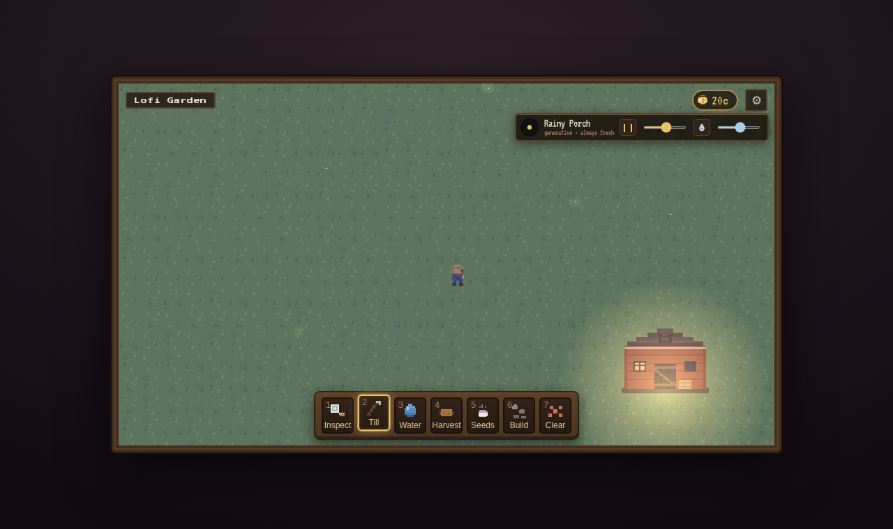

# Lofi Garden

[](https://github.com/abhijit-the-ghost/lofi-garden/actions/workflows/ci.yml)

A cozy top-down pixel-art garden & farm builder. Queue the work — a little farmer tends it.
Rain on the roof, coins in the pouch, a generative lofi loop always on.

**[Play in your browser →](https://abhijit-the-ghost.github.io/lofi-garden/)**



## Run

```sh
bun install
bun run dev          # http://localhost:5180
bun run test         # vitest — grid / A* / queue / crops / deeds / save / farmer FSM
bun run verify:e2e   # full Playwright click-through (local, needs bun + chromium)
bun run build        # type-check + production bundle (dist/)
bun run dist:zip     # dist/ + a ready-to-upload itch.io HTML5 bundle (dist.zip)
bun run og:card      # rebuild public/og.png (needs the dev server port free)
```

## Controls

| Input | Action |
| --- | --- |
| Left click / drag | Apply the active tool (Till, Inspect) |
| Right click | Unqueue pending task under cursor · otherwise back to Inspect |
| Right drag | Pan the camera (world follows your hand) |
| WASD / Arrows | Pan the camera |
| `1`–`7` | Hotbar slots · `Esc` → Inspect |

## Play it elsewhere

The game is a fully static site — `dist/` is the whole artifact. Upload `dist.zip`
(or download the `lofi-garden-dist` artifact from any CI run) to itch.io as an
**HTML5** project: viewport `1280×720`, check "SharedArrayBuffer not needed".
GitHub Pages is deployed automatically on every push to `main`.

## Layout

- `src/game/` — fixed-timestep simulation: tile grid, A*, FIFO task queue, farmer FSM, camera, sprites (`assets.ts` behind a manifest abstraction — a real sprite sheet can drop in later)
- `src/state/bridge.ts` — immutable snapshot bridge (`useSyncExternalStore`) between the mutable world and React
- `src/ui/` — hotbar, start overlay (wood & parchment CSS, VT323 + Press Start 2P, fully offline)
- `src/tests/` — vitest suites for pathfinding, queue, grid, crops, deeds, save/migration, audio tables, lighting, orders, sprinklers & rain, farmer FSM
- `scripts/` — `verify-e2e.cjs` (headless click-through), `make-og.cjs` (regenerates the social card)
- Saves live in `lofi-garden-save-v1` (sparse, versioned); corrupt files quarantine to `lofi-garden-save-corrupt`, never half-applied
- `test-interact.cjs` · `test-m2.cjs` — farming loop · `test-m3.cjs` — build/deeds · `test-m4.cjs` — audio · `test-m5.cjs` — persistence · `test-m6.cjs` — day/night & settings · `test-m7.cjs` — rain / sprinklers / notice board: `bun run verify:e2e` runs them all
- Why v1.1 changed the save format: `lofi-garden-save-v1` is now written at `version: 2` (adds the day/night clock and notice-board orders); v1 files migrate silently on load and the farm keeps its coins, deeds, crops and barn

## A note on the save key

The localStorage key is `lofi-garden-save-v1` forever — it is the migration anchor every
past and future save hangs off. The `-v1` refers to the key, not the payload: the payload
is `version: 2` (and future migrations will bump it to 3, 4… inside the same key).
Renaming the key would strand every existing farm for zero user benefit, so we never will.

## Roadmap

- [x] **M1–M7** — the whole cozy pocket: scaffold → crops & coins → deeds & structures → procedural lofi audio → saves → day/night → rain, sprinklers & orders
- [x] **M8** — Launch & packaging: git history, GitHub Actions CI (test + build on every push), auto-deploy to GitHub Pages, ready-to-upload itch.io `dist.zip`, favicon + Open Graph card, MIT license, curated screenshots
- [ ] **M9** — Engineering hardening: rain respects land ownership (like sprinklers), one rain-ownership rule everywhere, stale-rain UI fix, refund/queue/clip deduplication, `describeTile` pulled out of the sim layer, memoized snapshot pin rebuild, dead code removed, unified version strings, Playwright declared + `verify:e2e`, farmer-FSM test suite
- [ ] **M10** — Sprout Lands reskin: handmade 16×16 world & farmer sprites (Sprout Lands Basic + in-house pixel art in matching style), four-direction farmer with tool-specific swing animations, order-complete jump, coin-pop / splash / till-dust / ripe-sparkle juice, UI press feedback, `:focus-visible` + `prefers-reduced-motion`

## Credits

- **Code & in-game procedural art** — MIT © 2026 Abhijit Guragain (see `LICENSE`)
- **Sprout Lands — Basic Pack** — pixel art by [Cup Nooble](https://cupnooble.itch.io/sprout-lands-basic-pack) (used under the pack's free license)
- **Fonts** — [VT323](https://fonts.google.com/specimen/VT323) and [Press Start 2P](https://fonts.google.com/specimen/Press+Start+2P) by Peter Hull & CodeMan38, via Fontsource (OFL)
- Music, ambience and SFX are generated at runtime — there are no audio files to license.

## License

[MIT](LICENSE) for the code. Art is credited above and in the game (start screen & settings).
